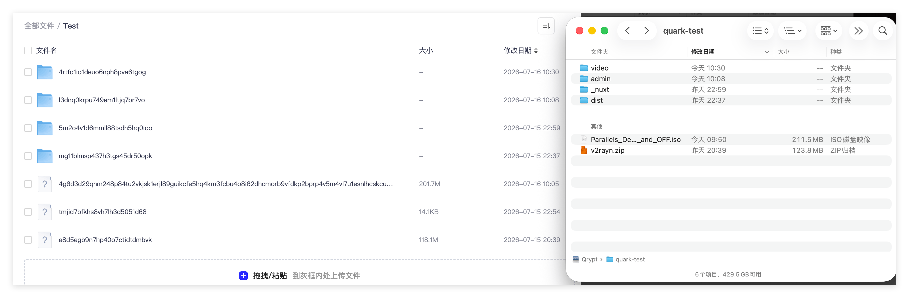

[English](README.md)

# qrypt

[](https://github.com/yinzhenyu-su/qrypt/actions/workflows/ci.yaml)
[](https://github.com/yinzhenyu-su/qrypt/actions/workflows/contract.yaml)
[](https://github.com/yinzhenyu-su/qrypt/actions/workflows/nightly.yaml)
[](https://go.dev)
[](LICENSE)
[](https://github.com/yinzhenyu-su/qrypt/releases)
[](#系统要求)

把你的云盘变成一个加密本地文件夹 —— 挂载、打开、像普通硬盘一样用。



## 简介

qrypt 将云盘映射为一个加密的本地文件夹。挂载后，可以像使用普通磁盘一样浏览和编辑文件。

- **统一入口** —— 多个云盘挂载到同一目录，各自拥有独立子目录
- **加密存储** —— 文件名和内容在写入云盘前加密，兼容 rclone crypt
- **异步写入与本地缓存** —— 写入先保存到本地，再后台上传；重复读取命中缓存
- **跨平台** —— 支持 macOS、Linux 和 Windows
- **无需挂载** —— 通过 `qrypt fs` 直接读写云端文件，也可用于脚本和服务器

## 安装

**Linux / macOS**

```sh
curl -fsSL https://github.com/yinzhenyu-su/qrypt/releases/latest/download/install.sh | sh
```

**Windows**（在任意终端中运行，不必先打开 PowerShell）

```powershell
powershell -c "irm https://github.com/yinzhenyu-su/qrypt/releases/latest/download/install.ps1|iex"
```

安装脚本会自动选择适合你系统的版本，无需管理员权限。装好后**打开一个新终端**，运行 `qrypt version` 确认。

升级和卸载：`qrypt upgrade` / `qrypt uninstall`（详见[快速上手](docs/for-user/quickstart.md)）。

## 快速体验

以下示例使用本地目录模拟云盘，无需云盘账号，可完整体验配置、上传、读取和加密效果。

### 1. 创建配置文件

```toml
version = "1"

[mount]
mount_point = "~/Qrypt"

[[mounts]]
name = "local"
type = "localfs"

[mounts.params]
root_path = "/tmp/qrypt-data"

[mounts.encryption]
password = "my-password"
filename_encryption = "standard"
filename_encoding = "base32"
```

### 2. 上传并读取文件

```bash
mkdir -p /tmp/qrypt-data
echo "hello qrypt" > /tmp/hello.txt

qrypt fs list /
qrypt fs put /tmp/hello.txt /local/hello.txt
qrypt fs cat /local/hello.txt
```

最后一条命令会输出 `hello qrypt`。

### 3. 查看加密结果

```bash
ls /tmp/qrypt-data
```

文件名会显示为类似 `b4l6gr1s6t1q0tas6dl0q0mb0s62kbj0` 的乱码，文件内容也已加密。

## 挂载为本地文件夹（可选）

```bash
qrypt mount
```

打开文件管理器进入 `~/Qrypt`，就能像操作普通文件夹一样拖入、打开、删除文件。

> 只有 `mount` 需要 FUSE：macOS 装 [macFUSE](https://macfuse.io/)，Windows 装 [WinFsp](https://winfsp.dev/)。`fs` 命令不需要。

详细教程（含 Windows 注意事项）→ [快速上手](docs/for-user/quickstart.md)

## 系统要求

| 依赖           | macOS                          | Linux                         | Windows                       |
| -------------- | ------------------------------ | --------------------- | ----------------------------- |
| FUSE           | [macFUSE](https://macfuse.io/) | libfuse3 / fuse3              | [WinFsp](https://winfsp.dev/) |
| Go（源码构建） | 1.27+                          | 1.27+                 | 1.27+                         |

配置文件会自动查找：`./qrypt.toml`、`~/.qrypt/qrypt.toml`，然后 Unix 上的
`$XDG_CONFIG_HOME/qrypt/qrypt.toml` 或 Windows 上的 `%AppData%\qrypt\qrypt.toml`。
放在这些位置时可以省略 `--config`（见[命令行参考](docs/for-user/cli.md)）。

## 用户文档

- [快速上手](docs/for-user/quickstart.md) — 安装、升级与卸载，最小配置，约 5 分钟完成首次体验，含加密效果演示
- [命令行参考](docs/for-user/cli.md) — 命令、参数、输入输出和配置查找规则
- [离线下载](docs/for-user/offline-download.md) — 把磁力链或下载链接交给网盘侧下载
- [夸克网盘扫码登录](docs/for-user/quark-login.md) — 扫码获取 cookie，保存为共享凭据并创建挂载
- [分享与接收](docs/for-user/share.md) — 分享网盘内容，或转存/下载别人的分享链接
- [常见问题](docs/for-user/troubleshooting.md) — 挂载点残留、上传队列等故障排查
- [完整配置参考](docs/for-user/full-config.md) — 全部配置项说明
- [支持的驱动](docs/for-user/support-drivers.md) — 各云盘驱动的参数列表

## 开发者文档

- [架构概览](docs/for-developer/architecture.md) — 分层设计与规则
- [包边界](docs/for-developer/package-boundaries.md) — 职责所有权、禁止依赖与迁移验收标准
- [驱动开发](docs/for-developer/driver-development.md) — 如何接入新的云盘后端
- [调试](docs/for-developer/debug.md) — 诊断工具和故障排查
- [Fuzz 样本管理](docs/for-developer/fuzz-corpus.md) — nightly fuzzing 与回归样本流程
- [质量门禁](docs/for-developer/quality-gates.md) — CI workflow、覆盖率门禁、contract 矩阵

## 从源码构建

需要 Go 1.27+ 和 FUSE 头文件（Linux 上为 libfuse3-dev，运行挂载还需要
fuse3 与 `/dev/fuse`；macOS 上为 macFUSE）。Linux 默认使用 FUSE3；老系统
可用 `-tags fuse2` 构建兼容版本。

```
git clone https://github.com/yinzhenyu-su/qrypt.git
cd qrypt
go build ./cmd/qrypt
```

## 许可证

MIT
